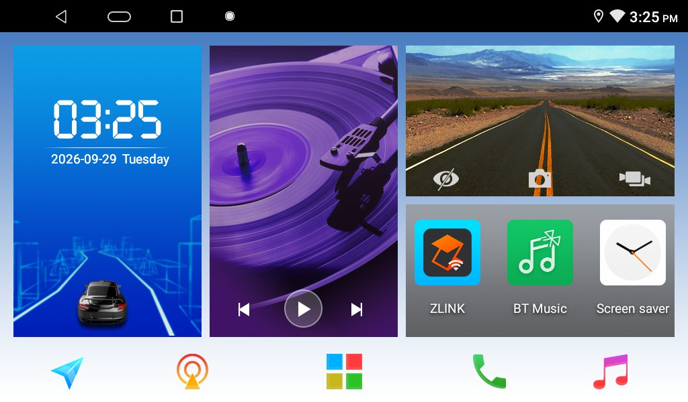
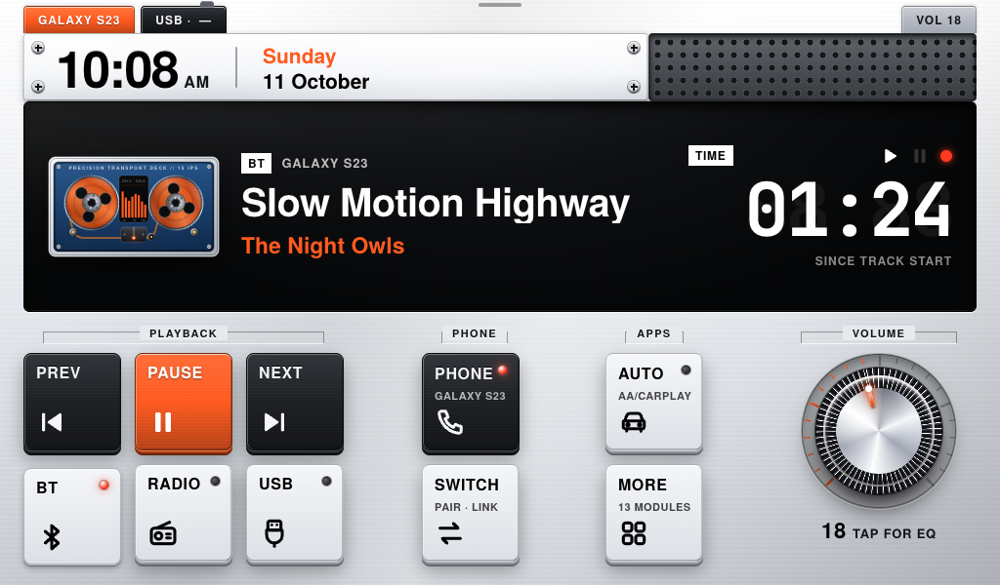
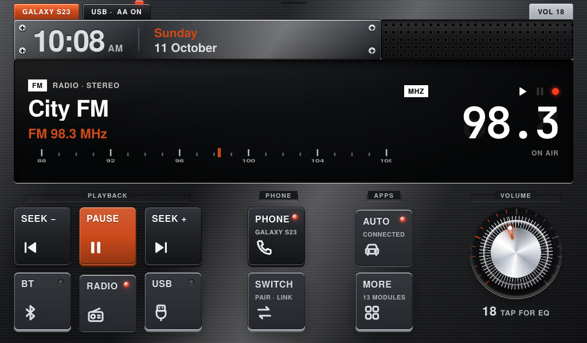
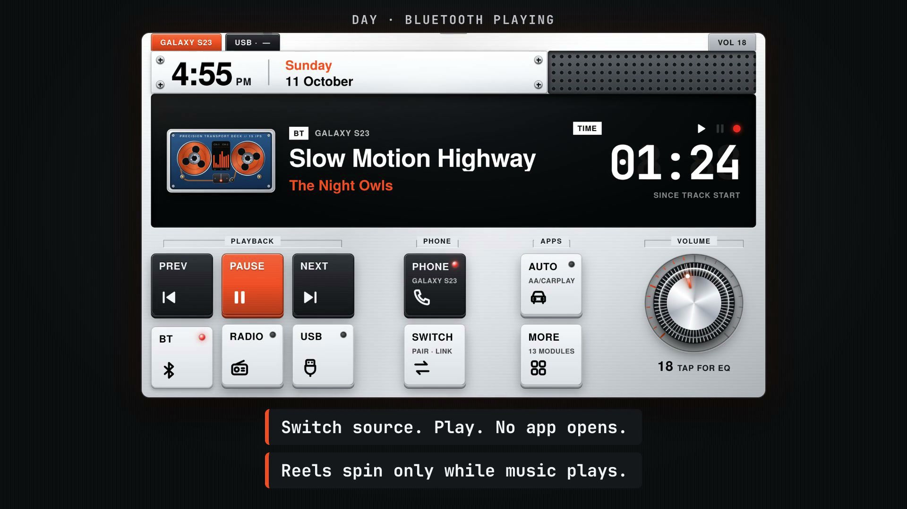

# Calm: I hated my car's infotainment screen, so I replaced it

My car has a Chinese-made Android head unit (NWD K2501). It works, but I hated how its stock home screen looked every single time I got in. So I built my own: **a native Android launcher that replaces it**, pixel-matched to a design I made in HTML first.

| Before: the stock home screen | After: Calm |
|---|---|
|  |  |

*Left: the head unit's stock launcher, shown for comparison. Right: a render of the HTML mockup in `mockup/`; the app on the unit is pixel-matched to it.*

It puts what's playing in the middle of the screen, a few big physical-looking keys under it, and gets out of the way when Android Auto, a call, or the reverse camera takes over. At night (headlights on) it switches to a dark theme:



**Watch the 25-second launch trailer** (a straight-faced keynote parody; every number in it is measured, and the fine print is honest):

[](docs/calm-launcher-trailer.mp4)

## What it does
- **Now playing is the main thing:** Bluetooth song and artist, FM station and frequency, or the USB track, with an animated tape deck that only moves while music plays.
- **BT / RADIO / USB keys switch the source and start playing in place**, with no app opening. Prev / Play / Next / Seek work for each source.
- **Phone:** shows the connected phone and opens the stock phone app to call or switch phones.
- **Android Auto / CarPlay** (via the unit's zlink app) opens by itself when the phone connects, but never over the reverse camera or a call.
- **Starts the music when the phone connects** (can be turned off in Home settings).
- Volume knob that follows your finger and shows the real stereo volume; day / graphite / night themes that follow the headlights.

## How it works
The unit's only WebView is from 2019, so it can't render the mockup's CSS. Instead of a WebView app:

1. The design lives in one HTML file, `mockup/index.html`, which you can open in any browser. It has a simulator panel to fake signals (phone plugged in, reverse gear, headlights…).
2. `launcher/tools/bake.mjs` drives headless Chrome over the DevTools protocol and renders every graphic (about 290 images: each key up and down, three themes, five accent colours) plus a `layout.json` with positions and every text style Chrome measured.
3. The Kotlin app composes those images with plain `View` + `Canvas` and draws only what changes: clock, text, lights, knob angle, reels, level meter. No AndroidX, no libraries.
4. It talks to the head unit the way the stock launcher does: broadcasts, `Settings.System` values, and two vendor AIDL services called with raw binder transactions. See [docs/INTEGRATION.md](docs/INTEGRATION.md).

Measured on the unit: about 22 MB of memory, returning to Home in about 175 ms (cold start about 650 ms after a reboot), release APK about 3.3 MB.

## Repo layout
```
mockup/     the design: index.html + fonts (open in a browser)
launcher/   Android project (Kotlin), bake tool, install / rollback scripts
eq/         optional audio tune for the unit's AK7602 DSP (see warnings)
docs/       integration notes, test plan, screenshots
```

## Build
Needs JDK 17 and the Android SDK (platform 34). Put `sdk.dir=/path/to/Android/sdk` in `launcher/local.properties`, or set `ANDROID_HOME`.
```sh
cd launcher
./gradlew assembleRelease        # app/build/outputs/apk/release/app-release.apk (debug-signed)
```
After changing `mockup/index.html`, re-render the assets (Node 22+ and Google Chrome; set `CHROME=` if it isn't in a standard place):
```sh
node tools/bake.mjs
```

## Install on a head unit — read this first
This is **experimental software for one specific device and firmware**. It needs root ADB over Wi-Fi and changes system settings. I only tested it on my own NWD K2501 (Android 10). Use it at your own risk, and nothing here is meant to be used while driving.

```sh
cd launcher
UNIT=192.168.1.50:5555 ./scripts/install.sh     # build, install, make it the default Home
UNIT=192.168.1.50:5555 ./scripts/rollback.sh    # stock launcher back as Home
```
What `install.sh` changes: installs the app; grants it the `SYSTEM_ALERT_WINDOW` app-op and `READ_LOGS`; and sets the system property `persist.nwd.launcher.default` (NWD's firmware picks the Home app from it and ignores Android's normal setting). While running, the app also sets the LCD contrast and saturation by writing to the display's files under `/sys/devices/virtual/disp/` (65 by day, the factory 50 at night), which only works with root. The stock launcher is **never disabled**: its services keep running and `rollback.sh` restores everything. If Calm ever misbehaves and the screen is unusable, from a computer run `adb shell setprop persist.nwd.launcher.default com.android.launcher` (or `adb uninstall com.calm.launcher`).

**`eq/` is riskier:** `apply.sh` overwrites the stock DSP settings file and locks its folder read-only. The values are tuned for my car and speakers (speaker delays, bass boost). Try them at low volume, keep `eq/original.xml` to undo, and don't expect them to suit another car.

## Privacy and permissions
- **No internet permission.** The app can't send anything off the unit, and it stores only a few settings and the last source in its own private preferences.
- `READ_LOGS` is used for one thing: reading the Bluetooth daemon's log tag (`nwdbt`) to get a song's length, which the stock Bluetooth app doesn't pass on. It is filtered to that tag and nothing is saved.
- `SYSTEM_ALERT_WINDOW` lets it start Android Auto while another app is in front.

## Legal and credits
- Not affiliated with or endorsed by NWD, zlink, Google or Teenage Engineering. Product names belong to their owners. The look is *inspired by* Teenage Engineering's EP-series hardware; no TE artwork or fonts are used.
- The "Before" image is a screenshot of the head unit's stock launcher, shown only for comparison. Its artwork belongs to the vendor.
- **No vendor code or firmware is included.** Action strings, setting names and AIDL transaction numbers were found by observing the unit's own apps, for interoperability, and are listed in `docs/INTEGRATION.md`. `MusicBean.kt` is a small reimplementation of a data class's wire format, needed to read the USB player's broadcasts.
- Fonts: [TeX Gyre Heros](https://www.gust.org.pl/projects/e-foundry/tex-gyre) (GUST Font License / LPPL 1.3c) stands in for Helvetica Neue, and [JetBrains Mono](https://www.jetbrains.com/lp/mono/) (SIL OFL 1.1) for the monospace text. Licences are in `launcher/app/src/main/assets/fonts/` and `mockup/fonts/`.
- Trailer: music is "Happy Beats / Business Moves" by [ende.app](https://ende.app) (CC BY 4.0); sound effects are from [Kenney](https://kenney.nl) (CC0). Made with [Hyperframes](https://hyperframes.heygen.com/).
- Code: [MIT](LICENSE).
